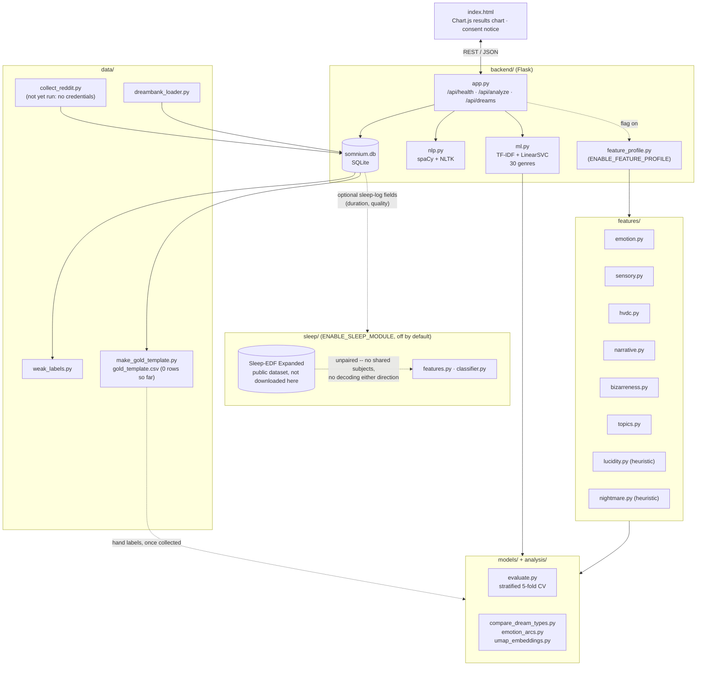

# Somnium

A dream journal. You write down a dream; a Flask backend classifies its
genre, extracts keywords and named entities, and (behind a flag) scores
it on a set of text features — emotion arc, bizarreness, sensory
density, lucid probability. A separate, explicitly unpaired module
explores the published link between REM sleep and dream-report
properties using public EEG data.

   

## The problem

A dream journal that just stores text doesn't help you notice
patterns across dozens of entries — which dreams were nightmares, what
your lucid dreams have in common, whether your dreams get more bizarre
or more emotionally negative as they go. Somnium's original version
(the Flask + spaCy/NLTK + TF-IDF/LinearSVC pipeline in `backend/`)
already classifies each dream into one of a fixed set of narrative
genres. This extension adds the pieces needed to go further: a way to
actually collect a real corpus of dreams, text features worth
comparing dreams on, model comparisons run the right way (cross-
validated, not eyeballed), and — carefully separated and labeled as
such — a look at what sleep research says should correlate with dream
properties.

**What's real here vs. what's scaffolding**, up front: the Reddit
collection has not actually been run (no API credentials in this
environment), so there are 0 real collected dreams and every "result"
below was computed on either the original 240-sentence synthetic
genre corpus or on synthetic test signals. Every number in this
document came from an actual run of the code in this repo — none are
invented — but "actual run" and "ran on real dream text" are not the
same claim, and this README says which is which at every turn. See
`data/README.md` for the full accounting.

## Architecture



The dashed lines are the two places this is honest about *not* being
fully wired yet: `feature_profile.py` only runs when its flag is on,
and `sleep/` is explicitly disconnected from the text pipeline — see
[docs/biology_link.md](docs/biology_link.md).

## Data

| Source | Rows collected | Status |
|---|---|---|
| r/dreams, r/LucidDreaming, r/Nightmares (`data/collect_reddit.py`) | 0 | Script is written, tested, and resumable — not run (no Reddit API credentials in this environment) |
| Local DreamBank file (`data/dreambank_loader.py`) | 0 | Written, tested against a synthetic fixture — not run (no DreamBank file available) |
| Synthetic genre corpus (`backend/ml.py`) | 240 (30 genres × 8 sentences) | The only labeled dataset that actually exists right now; used as a sanity-check dataset throughout `models/` and `analysis/` |
| `data/gold_template.csv` (hand labels, the only metric-worthy labels) | 0 | Sampling script (seed 42) is written and tested; produces a 0-row file today because there's nothing to sample from yet |

Full collection methodology, filtering rules (deleted/removed posts,
<50 words, non-English, duplicates), selection bias, and Reddit API
terms: [data/README.md](data/README.md).

## Method

- **Genre classification (baseline, unchanged):** TF-IDF (1-2 grams) →
  `CalibratedClassifierCV(LinearSVC)`, 30 genres (expanded from the
  original 10 — see `backend/ml.py`).
- **Model comparison (new, `models/`):** the baseline compared against
  (a) TF-IDF + hand-engineered features (`features/`) → Logistic
  Regression, and (b) `all-MiniLM-L6-v2` sentence embeddings → Logistic
  Regression, via stratified 5-fold cross-validation
  (`models/evaluate.py`). A DistilBERT fine-tune is implemented behind
  `ENABLE_DISTILBERT` but not run (no GPU in this environment).
- **Feature extraction (new, `features/`):** emotion arc (VADER
  valence per sentence, start/end/slope), sensory-word ratios,
  simplified Hall-Van de Castle counts, narrative structure (length,
  tense, first-person ratio), bizarreness (cosine distance between
  consecutive sentence embeddings), BERTopic themes, and lucid/
  nightmare signals — the last two are keyword heuristics, not trained
  classifiers, because no gold-labeled data exists yet to train on.
- **Statistical comparison (new, `analysis/`):** Cohen's d and
  bootstrap confidence intervals (`analysis/stats.py`) for
  nightmare-vs-lucid-vs-general comparisons on every feature.
- **Sleep biology (new, `sleep/`, off by default):** Welch PSD band
  power (delta/theta/alpha/sigma/beta) per 30s epoch, logistic
  regression sleep-stage classifier with a *subject-wise* train/test
  split (no subject's epochs in both sets), evaluated by accuracy,
  macro-F1, and Cohen's kappa.

All randomness is seeded (`seed=42` is the convention used throughout
`data/`, `features/`, `models/`, `analysis/`, and `sleep/`).

## Results

**Genre model comparison** — stratified 5-fold CV on the 240-example
synthetic genre corpus (the only labeled genre data available; see the
Data section above):

| Model | Macro-F1 |
|---|---|
| Baseline: TF-IDF + LinearSVC | 0.159 |
| TF-IDF + hand-engineered features + LogisticRegression | 0.132 |
| `all-MiniLM-L6-v2` + LogisticRegression | **0.598** |

Absolute scores are low because each class has only ~8 examples; the
*relative* result (pretrained sentence embeddings generalize far
better than sparse TF-IDF at this sample size) is a real signal from
this run. Full writeup: [models/README.md](models/README.md).

**Nightmare vs. lucid vs. general** — same corpus's Nightmare (n=8) /
Lucid (n=8) / other-28-genres (n=224) split, Cohen's d + bootstrap CI,
`analysis/compare_dream_types.py` / `analysis/emotion_arcs.py`:

- Aggression word count: nightmare > lucid, Cohen's d = **-0.76** (95% CI for the difference: [-0.50, 0.00]).
- Emotion-arc end valence: lucid > nightmare, Cohen's d = **+1.20** (95% CI: [0.09, 0.66], excludes 0).
- Emotion-arc slope is 0.0 for every group — the corpus is single-sentence, so there's no within-dream trajectory to measure. Real limitation of the sanity-check data, not a bug.

Full writeup, including the honesty caveat that this is synthetic
data standing in for real dream text: [analysis/README.md](analysis/README.md).

**Test suite:** 187 tests pass across `backend/`, `data/`, `features/`,
`models/`, `analysis/`, and `sleep/` (run `backend/venv/bin/python3 -m pytest backend data features models analysis sleep`).

## How to run it

```bash
cd backend
python3 -m venv venv && source venv/bin/activate   # or use the existing venv/
pip install -r requirements.txt
cp .env.example .env   # fill in Reddit credentials if you want to collect real data

python3 app.py          # starts the Flask API on :5000
# in another terminal, or just open index.html directly in a browser
```

**Feature flags** (`backend/.env`, all off by default):

| Flag | Effect |
|---|---|
| `ENABLE_FEATURE_PROFILE` | `/api/analyze` additionally returns emotion arc, bizarreness, sensory ratios, lucid probability |
| `ENABLE_SLEEP_MODULE` | Adds `sleep_duration_hours`/`sleep_quality` columns to `dreams` and accepts them on `POST /api/dreams` |
| `ENABLE_DISTILBERT` | Allows `models/train_distilbert.py`'s fine-tuning path to run (otherwise it raises) |

**Run the tests:**

```bash
backend/venv/bin/python3 -m pytest backend data features models analysis sleep       # everything
backend/venv/bin/python3 -m pytest backend data features models analysis sleep -m "not slow"  # skip the real-model tests (sentence-transformers/BERTopic/UMAP)
```

**Collect real data, once you have Reddit credentials:**

```bash
backend/venv/bin/python3 data/collect_reddit.py
backend/venv/bin/python3 data/make_gold_template.py   # then hand-label data/gold_template.csv
backend/venv/bin/python3 models/evaluate.py            # re-run once gold labels exist
backend/venv/bin/python3 analysis/compare_dream_types.py
```

## Limitations

- **No real dream corpus yet.** Every model/analysis number above is a
  pipeline sanity check on synthetic data, not a finding about real
  dreams. See `data/README.md`.
- **Reddit sampling, once run, will be biased**: recent/high-scoring
  posts only (API listing cap), self-selected posters, and
  over-representation of nightmare/lucid content by construction of
  which subreddits are sampled.
- **HVdC counts are a simplified word-list approximation**, not the
  validated human-coded system (`features/hvdc.py`).
- **Lucid/nightmare detection is a keyword heuristic**, not a trained
  classifier, until gold labels exist (`features/lucidity.py`,
  `features/nightmare.py`).
- **Posting time ≠ dream time** (`analysis/posting_time.py`'s own
  caveat, enforced in its docstring).
- **The sleep module is unpaired with the text pipeline** — see
  `docs/biology_link.md`. No GPU was available to run DistilBERT
  fine-tuning or real Sleep-EDF downloads in this environment.

## Ethics

- No Reddit username is ever stored (`data/collect_reddit.py` reads
  `submission.author` only to detect deletion, never persists it).
- Only public, non-deleted/removed posts are collected, filtered, and
  the collection must comply with Reddit's Data API Terms — see
  `data/README.md`.
- `/api/analyze` always returns a non-diagnostic disclaimer; the sleep
  correlation view (`sleep/correlation.py`) is explicitly documented
  as descriptive-only, never medical/diagnostic — see
  `docs/biology_link.md`.
- A consent notice is shown on first use of the web UI, explaining
  what's stored and that results aren't medical advice.

## Project structure

```
Somnium/
├── index.html              ← Frontend (Chart.js results chart, consent notice)
├── backend/                 ← Flask API, SQLite, NLP/ML, config flags
├── data/                    ← Reddit/DreamBank collection, weak labels, gold template
├── features/                ← Pure dream-text feature extractors
├── models/                  ← Genre-classifier comparison + stratified CV
├── analysis/                ← Effect sizes, bootstrap CIs, UMAP viz
├── sleep/                   ← EEG sleep-stage module (flagged, off by default)
├── docs/biology_link.md     ← What the sleep module does and does not claim
└── reports/                 ← Generated metrics/plots (gitignored)
```

Each subdirectory has its own `README.md` with full details and its
own `pytest` test suite.

## Every file this extension added or changed

Starting from the original Flask backend (commit `ff5b588`) through
this README:

**Modified:** `.gitignore`, `backend/app.py`, `backend/db.py`,
`backend/ml.py`, `backend/nlp.py`, `backend/requirements.txt`,
`index.html`.

**Added — foundation:** `backend/config.py`, `backend/.env.example`,
`backend/pytest.ini`, `backend/tests/` (conftest + 5 test files).

**Added — data/:** `collect_reddit.py`, `dreambank_loader.py`,
`text_cleaning.py`, `weak_labels.py`, `make_gold_template.py`,
`README.md`, `pytest.ini`, `tests/` (6 test files).

**Added — features/:** `emotion.py`, `sensory.py`, `hvdc.py`,
`narrative.py`, `embeddings.py`, `bizarreness.py`, `topics.py`,
`lucidity.py`, `nightmare.py`, `README.md`, `pytest.ini`, `tests/`
(8 test files).

**Added — models/:** `paths.py`, `dream_features.py`,
`train_logreg_tfidf_features.py`, `train_sbert_logreg.py`,
`train_distilbert.py`, `evaluate.py`, `README.md`, `pytest.ini`,
`tests/` (5 test files).

**Added — analysis/:** `paths.py`, `stats.py`,
`compare_dream_types.py`, `emotion_arcs.py`, `posting_time.py`,
`umap_embeddings.py`, `README.md`, `pytest.ini`, `tests/` (6 test
files).

**Added — sleep/:** `features.py`, `classifier.py`, `hypnogram.py`,
`correlation.py`, `download_sleep_edf.py`, `README.md`, `pytest.ini`,
`tests/` (4 test files).

**Added — backend app wiring:** `backend/feature_profile.py`,
`backend/tests/test_app_analyze.py`.

**Added — docs:** `docs/biology_link.md`, this `README.md` rewrite.

**Left untouched, as requested:** the pre-existing `dreams` table and
all its columns, every existing API endpoint's response shape
(extensions are additive, behind flags), the 10 original genre labels
and their training sentences, and two unrelated local changes already
present when this work began (`somnium.html` deletion, untracked
`somnium.db`).
